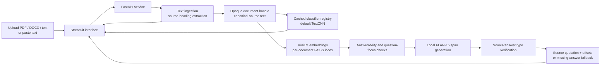

# Architecture — Medical Document Assistant

## Training plane

1. openFDA labels are downloaded with source/query manifests and checksums.
2. Clinical sections are normalized; class targets use explicit EPC mappings.
3. Ingredient/near-duplicate-aware record splits are frozen before model training.
4. Classical ML, TextCNN, and compact BERT models are selected on validation.
5. Artifacts record data/split/config provenance, class order, and feature settings.

## Serving plane

- `streamlit_app.py` handles upload/paste, source results, and document-specific chat.
- `api.py` exposes `/health`, `/models`, `/documents`, `/documents/upload`,
  `/classify`, `/extract`, `/ask`, and document read/delete routes.
- `serving.py` caches models and serializes shared tokenizer/model inference.
- `ingestion.py` reads text-based PDF, DOCX, HTML, and text; extracted fields are
  source passages with exact offsets, not generated medical facts.
- Each API upload receives an opaque UUID. Identical text can share an internal
  vector index while retaining separate external document handles.
- User document/index data is separate from training artifacts and expires or is
  cleared through the application. A new document resets the frontend conversation.
- The classifier does not select the QA evidence document. All QA evidence comes
  from the current document handle.
- Conversation context is kept only on that document handle and resolves short
  follow-ups to the preceding answered topic. Uploading another document starts a
  separate conversation.
- The source-backed overview and suggested questions use recognized source
  sections. Citations map canonical offsets back to PDF pages, DOCX paragraphs or
  table rows, and text lines for highlighted source navigation.

## Deployment

One Docker container supervises FastAPI on internal port 8000 and Streamlit on
port 7860. Docker Compose exposes the frontend and a loopback-only API port for
local testing. Hugging Face Spaces uses port 7860 with its Docker SDK.

`docs/architecture.png` and `docs/architecture.svg` are generated from the same
architecture by `scripts/build_capstone_materials.py`.
