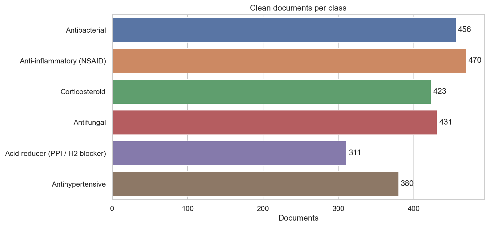
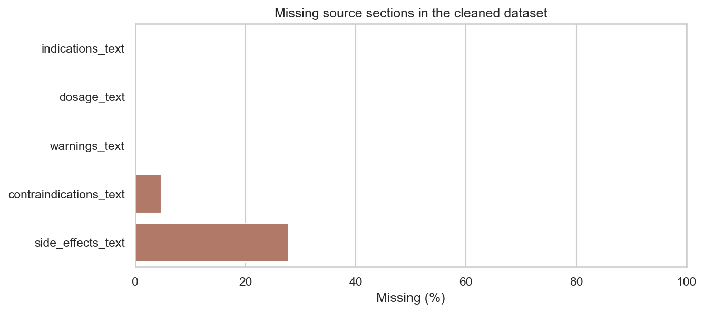
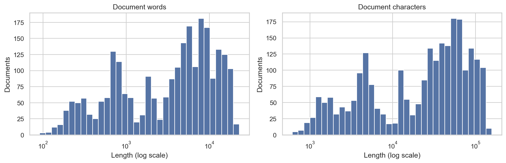
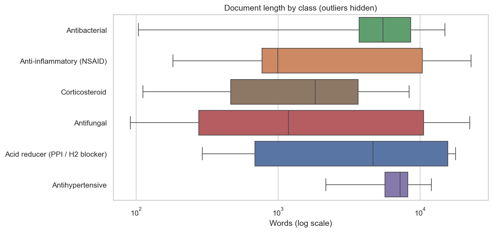
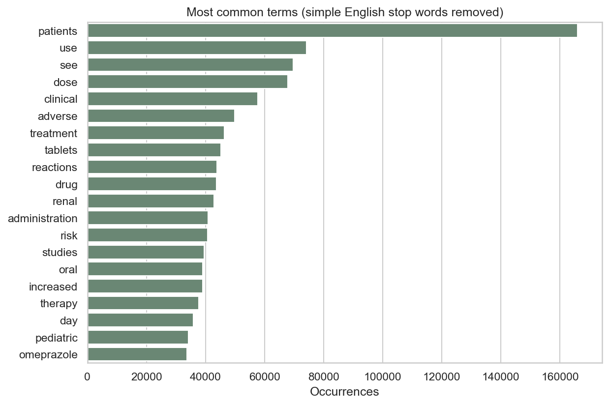

# Phase 1 — Review checkpoint

## Result

**2,471 real medicine-label documents across 6 classes** are ready
for review. The data was downloaded from openFDA, not generated. There are
0 synthetic documents.

- Raw records: **3,572**
- Retained: **2,471**; excluded with recorded reasons: **1,101**
- Unique ingredient sets: **175**
- Shared-ingredient leakage groups: **105**
- Median document length: **4,467 words**
- Length range: **91–22,945 words**
- Dataset integrity checks: **passed**
- Retrieved at: `2026-10-28T11:05:52+00:00`
- API snapshot last updated: `2026-10-27`

## Class balance

| Class | Documents | % | Leakage groups | Median words |
| --- | --- | --- | --- | --- |
| Antibacterial | 456 | 18.45 | 37 | 5478.0 |
| Anti-inflammatory (NSAID) | 470 | 19.02 | 15 | 995.5 |
| Corticosteroid | 423 | 17.12 | 12 | 1834.0 |
| Antifungal | 431 | 17.44 | 19 | 1185.0 |
| Acid reducer (PPI / H2 blocker) | 311 | 12.59 | 7 | 4662.0 |
| Antihypertensive | 380 | 15.38 | 19 | 7261.5 |

The largest/smallest class ratio is **1.51** after
cleaning. Download caps intentionally sample selected classes; this distribution
does not estimate the distribution of medicines in openFDA or clinical practice.

## Source collection

| Class | API matches | Downloaded |
| --- | --- | --- |
| Antibacterial | 1061 | 600 |
| Anti-inflammatory (NSAID) | 2448 | 600 |
| Corticosteroid | 1413 | 600 |
| Antifungal | 685 | 600 |
| Acid reducer (PPI / H2 blocker) | 790 | 600 |
| Antihypertensive | 730 | 600 |

Each class uses the exact EPC terms in [`../configs/phase1.json`](../configs/phase1.json),
limited to human prescription/OTC products. Results are ordered by
`effective_time:desc` and capped per class. Counts can overlap when a combination
product matches more than one query; raw IDs are deduplicated during collection.
Recent-label ordering can overrepresent repackagers, popular ingredients, and
recent updates. The cached raw snapshot and checksums preserve this experiment.

## Cleaning and exclusions

| Reason | Records |
| --- | --- |
| ambiguous_target_classes | 58 |
| duplicate_normalized_text | 1017 |
| short_or_empty_document | 26 |

Encoding and HTML are normalized while retaining numbers, units, inequalities,
negation, and medical wording. Source section boundaries are retained. Narrative
arrays are deduplicated when they repeat a complete subsection. Readable table
text is saved in `sections_json`, with a table fallback when a narrative section
is absent. Tables still require source inspection before interpreting doses.

The newest available version of an SPL set is retained. Identical normalized
documents are deduplicated. Texts with conflicting class labels and combinations
that match multiple selected categories are excluded. Unmapped extra EPCs remain
in metadata; the target is the unique match among the six chosen categories.
The full exclusion audit is in [`excluded_records.csv`](excluded_records.csv).

## Missing sections

| Source section column | Missing | Missing % |
| --- | --- | --- |
| indications_text | 2 | 0.08 |
| dosage_text | 8 | 0.32 |
| warnings_text | 7 | 0.28 |
| contraindications_text | 116 | 4.69 |
| side_effects_text | 688 | 27.84 |

Empty means the section is missing from the source record, not that the drug has
no warnings, contraindications, or side effects. Some OTC labels include these
facts in a general warnings section instead of the separate prescription fields.
No missing medical facts are invented. Raw-field missingness is also recorded in
[`cleaning_summary.json`](cleaning_summary.json).

## Text length and frequent terms

Lengths vary substantially between compact OTC leaflets and long prescription
labels. Future models will need an explicit text-length strategy. Frequency
tables use lowercase English words of at least three characters and a small
stop-word list; this EDA does not change the saved document text. See
[`common_terms_by_class.csv`](common_terms_by_class.csv) for class-specific terms.

## Duplicate-aware evaluation preparation

**86 groups contain multiple documents**;
the largest contains **772**. Exact-text
deduplication alone does not remove near-identical labels from different
manufacturers. `leakage_group_id` connects records sharing a source ingredient
name or UNII, including combination products. Phase 2 should keep these groups
disjoint in training, validation, and testing. Salt synonyms and additional
near-duplicate relationships should be reviewed before committing the split.

Groups can span several classes through combination-product links. These related
documents should share the same train/validation/test partition. See
[`leakage_groups.csv`](leakage_groups.csv) for group sizes and class coverage.

There are only 105 groups, so the independent evaluation
units are fewer than the document count. These labels cover selected drug classes;
prescriptions and health articles are not yet represented in the training corpus.

## What to review

1. Confirm the six starting categories in the class mapping.
2. Inspect `../data/processed/review_sample.csv` and its source links.
3. Review class balance, missing sections, and ingredient-group counts.
4. Open `../notebooks/01_data_collection_and_eda.ipynb` for the guided analysis.
5. Approve Phase 1 or request changes before Phase 2 starts.

## Deliverables

- `../data/raw/openfda_labels.jsonl.gz` — original API records
- `../data/raw/openfda_manifest.json` — source and query provenance
- `../data/processed/medicine_labels.parquet` — canonical clean dataset
- `../data/processed/medicine_labels.csv.gz` — CSV equivalent
- `../data/processed/review_sample.csv` — two complete documents per class
- `../src/medical_doc_assistant/cleaning.py` — reusable cleaning module
- `../notebooks/01_data_collection_and_eda.ipynb` — EDA notebook
- `validation.json` — dataset and export checks, with environment versions
- `../docs/data_card.md` — schema, terms, and limitations

## Scope checkpoint

This is the end of **Phase 1: Data + EDA pipeline**. The next planned course phase
is the TF-IDF baseline comparison and held-out evaluation, subject to your review.
Arabic is a later extension, consistent with the original plan's English-first
approach.

Data provided by the U.S. Food and Drug Administration (<https://open.fda.gov>).
Source terms: <https://open.fda.gov/terms/>. As stated in the plan, this project is
informational only and is not medical advice.
