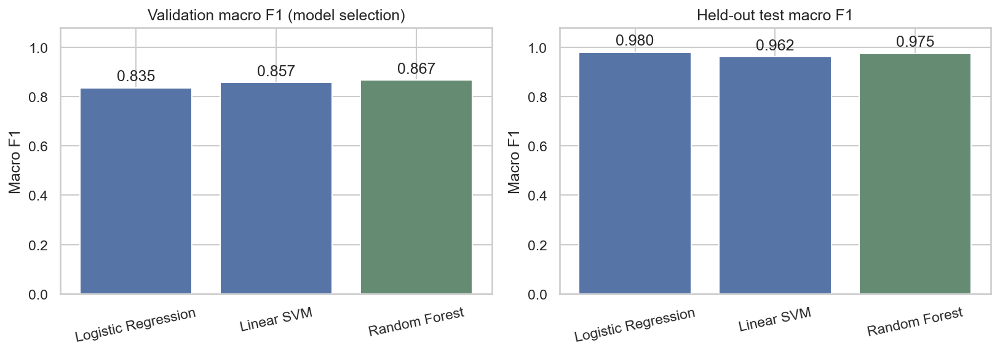
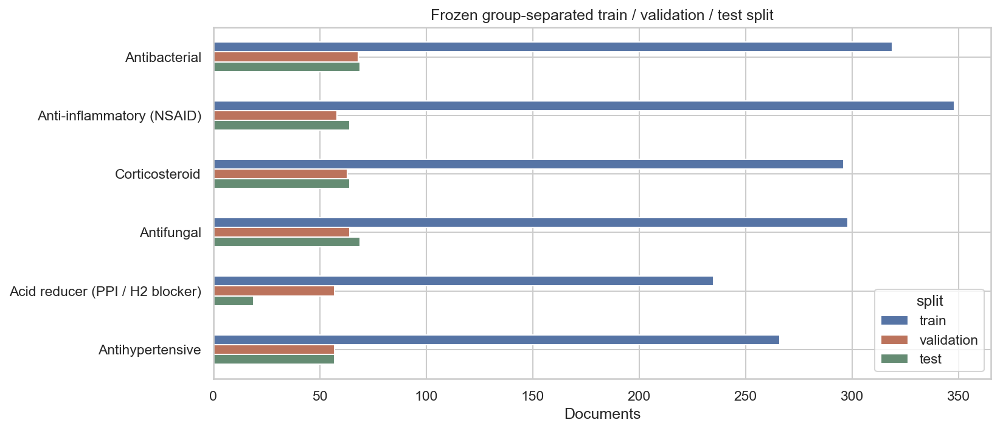
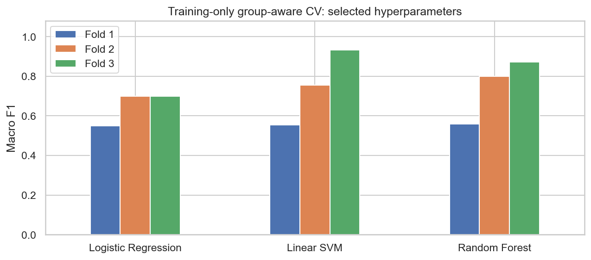
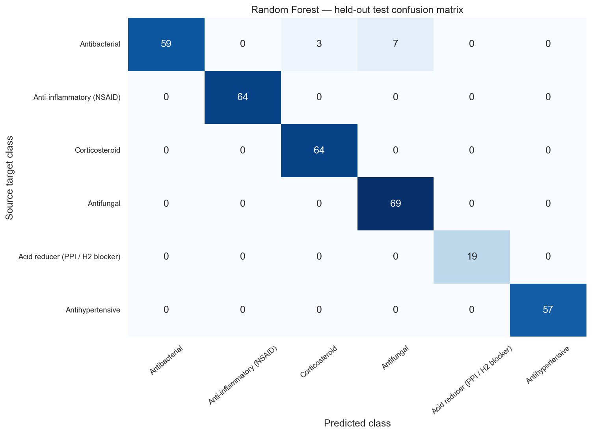
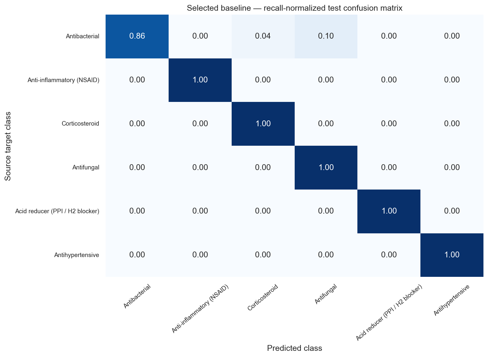

# Phase 2 — Baseline classifier review

## Result

**Random Forest** is the selected benchmark, chosen using validation
macro F1 before test evaluation. The standalone pipeline is saved at
`../models/phase2/benchmark.joblib`.

- Validation macro F1: **0.8671**
- Held-out test accuracy: **0.9708**
- Held-out test macro F1: **0.9751**
- Group-balanced test macro F1: **0.9688**
- Integrity verification: **75 checks passed**

All three planned families were trained: Logistic Regression, Linear SVM, and
Random Forest. Precision, recall, and F1 below are macro averages over the six
fixed target labels. Standard deviation is across the training CV folds.

## Model comparison

| Model | CV macro F1 ± SD | Validation F1 | Test accuracy | Test precision | Test recall | Test macro F1 | Benchmark |
| --- | --- | --- | --- | --- | --- | --- | --- |
| Logistic Regression | 0.6492 ± 0.0703 | 0.8355 | 0.9766 | 0.9815 | 0.9807 | 0.9799 |  |
| Linear SVM | 0.7472 ± 0.1547 | 0.8565 | 0.9561 | 0.9684 | 0.9638 | 0.9622 |  |
| Random Forest | 0.7436 ± 0.1344 | 0.8671 | 0.9708 | 0.9772 | 0.9758 | 0.9751 | Selected |

The most-frequent-class dummy reference has test accuracy
**0.1871** and macro F1
**0.0525**. This is a reference value,
separate from the three trained classifier families.

## Frozen evaluation data

| Partition | Documents | Groups | % of corpus |
| --- | --- | --- | --- |
| train | 1762 | 67 | 71.31 |
| validation | 367 | 18 | 14.85 |
| test | 342 | 15 | 13.84 |

The approved **2,471-document** Phase 1 dataset is used in
full. Record assignments are saved in `../data/splits/phase2_split.csv` for reuse
by later course models. Targets are approximately 70% / 15% / 15%; exact row
stratification is constrained by whole ingredient components. All six classes
appear in each partition and in each training CV fit/validation fold.

Ingredient grouping preserves all Phase 1 components and adds exact/normalized
RxNorm ingredient (IN) relationships. **251 of
259 substance names** have an unambiguous relationship
in the cached RxNorm `05-Oct-2026` release. Components changed from
**105 to 100**. Ambiguous/unmapped
names retain source-based grouping; no approximate name match is guessed.

A fixed, vocabulary-free hashed word-5-gram audit found
**0 additional cross-component pairs** at cosine
similarity ≥ 0.985 and word-count ratio ≥ 0.9. Qualifying
pairs are grouped before splitting. This thresholded audit is not a guarantee
that every possible semantic near-duplicate or chemical synonym is resolved.
The audit representation is used only for grouping, not classifier features.

Group allocation minimizes class-document and class-group balance deviations
subject to class coverage. At least three groups per training class permit
three-fold CV; holdouts retain at least two groups per class when inventory allows.
Solver settings, actual constraints, hashes, and assignments are recorded in
[`phase2/split_manifest.json`](phase2/split_manifest.json).

## Training and selection protocol

1. Freeze partitions using data/ingredient relationships, independently of model scores.
2. Fit TF-IDF and classifiers inside each of **three group-separated training CV folds**.
3. Select each family's hyperparameters by training CV macro F1.
4. Compare tuned families on the separate validation partition; select by macro F1.
5. Persist the selection, then refit each frozen candidate on train + validation.
6. Evaluate the refitted candidates on the held-out test partition for the comparison.

`document_text` is the sole feature input. Vocabulary and IDF are learned within
CV fit folds, then relearned on train + validation for final artifacts. Metadata,
IDs, group assignments, validation text during CV, and test text during fitting
are excluded. Class weights address remaining class-size imbalance. The selected
baseline remains the validation winner even if another family has a higher test
score. Test results are not used to change hyperparameters or the winner.

TF-IDF uses unigrams/bigrams, sublinear term frequency, `min_df=2`, `max_df=0.99`,
and up to 30,000 features. Clinical source text is retained without truncation.
Actual parameters and all grid/fold results are in
[`phase2/cv_results.csv`](phase2/cv_results.csv).

Large connected ingredient components make CV fold sizes and class supports
uneven. Fold-to-fold variation reflects this difficult held-out-family setting;
CV standard deviation is not a confidence interval. Class/fold support is
recorded in [`phase2/cv_class_balance.csv`](phase2/cv_class_balance.csv).

## Selected baseline: class-level test results

| Class | precision | recall | f1 | Test documents | Test groups |
| --- | --- | --- | --- | --- | --- |
| Antibacterial | 1.0 | 0.8551 | 0.9219 | 69 | 5 |
| Anti-inflammatory (NSAID) | 1.0 | 1.0 | 1.0 | 64 | 2 |
| Corticosteroid | 0.9552 | 1.0 | 0.9771 | 64 | 2 |
| Antifungal | 0.9079 | 1.0 | 0.9517 | 69 | 2 |
| Acid reducer (PPI / H2 blocker) | 1.0 | 1.0 | 1.0 | 19 | 2 |
| Antihypertensive | 1.0 | 1.0 | 1.0 | 57 | 3 |

All family confusion matrices are available under `phase2/figures/` and as CSV.
The normalized matrix shows recall per source target class.

## Repeated-label weighting and errors

| Model | Group-balanced test accuracy | Group-balanced test macro F1 |
| --- | --- | --- |
| Logistic Regression | 0.9111 | 0.9327 |
| Linear SVM | 0.9556 | 0.9643 |
| Random Forest | 0.963 | 0.9688 |

Group-balanced metrics give each test ingredient component total weight one
(each of its documents receives weight `1 / group_size`). This supplements the
standard document-level metrics when many labels describe one ingredient family.
The test set has only **15 independent
components**; these results describe this snapshot, not all medicines or clinical
practice. Some classes have few independent test ingredients.

The selected baseline made **10** test-document errors.
Example errors, when present:

| Source generic names | Source target | Prediction |
| --- | --- | --- |
| ["TOBRAMYCIN SOLUTION"] | antibacterial | antifungal |
| ["TOBRAMYCIN"] | antibacterial | antifungal |
| ["TOBRAMYCIN"] | antibacterial | antifungal |
| ["LOTEPREDNOL ETABONATE AND TOBRAMYCIN"] | antibacterial | corticosteroid |
| ["TOBRAMYCIN"] | antibacterial | antifungal |
| ["TOBRAMYCIN"] | antibacterial | antifungal |
| ["LOTEPREDNOL ETABONATE AND TOBRAMYCIN"] | antibacterial | corticosteroid |
| ["TOBRAMYCIN"] | antibacterial | antifungal |
| ["LOTEPREDNOL ETABONATE AND TOBRAMYCIN"] | antibacterial | corticosteroid |
| ["TOBRAMYCIN"] | antibacterial | antifungal |

Full error rows and source links are in
[`phase2/test_errors.csv`](phase2/test_errors.csv). Positive linear coefficients
or global forest feature importances are in
[`phase2/top_features.csv`](phase2/top_features.csv). Genuine drug/class mentions
in the clinical document remain text features; EPC label metadata is separate.

## Deliverables and review

- `../models/phase2/benchmark.joblib` — selected complete TF-IDF/classifier pipeline
- `../models/phase2/*.joblib` — all three refitted model families
- `../data/splits/phase2_split.csv` — frozen partition and CV assignments
- `../data/reference/rxnorm_ingredient_map.json` — source-backed ingredient mapping cache
- `phase2/model_comparison.csv` — CV, validation, test, and group-balanced metrics
- `phase2/predictions_test.csv` — reproducible held-out predictions
- `phase2/validation.json` — split, feature-fit, selection, artifact, and metric checks
- `../notebooks/02_baseline_classification.ipynb` — guided executed comparison notebook
- `../docs/baseline_model_card.md` — usage, scope, and limitations

Review the selected baseline, split/group coverage, CV variation, confusion
matrices, and source-linked errors. The next course phase is a PyTorch LSTM or
1D-CNN, after your review. Later models should reuse this split and tune with
training/validation data to preserve the benchmark comparison.

## Sources

Data provided by the U.S. Food and Drug Administration (<https://open.fda.gov>).
RxNorm reference terms: <https://lhncbc.nlm.nih.gov/RxNav/TermsofService.html>.

This product uses publicly available data from the U.S. National Library of Medicine (NLM), National Institutes of Health, Department of Health and Human Services; NLM is not responsible for the product and does not endorse or recommend this or any other product.

As specified in the original plan, the project is informational only and is not
medical advice. Current targets are operational EPC-derived categories for
English medicine labels; Arabic, other document types, and out-of-scope handling
remain later extensions.
