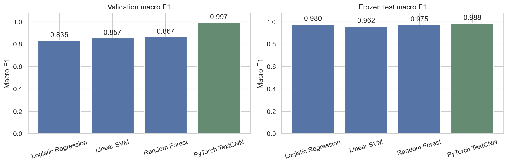
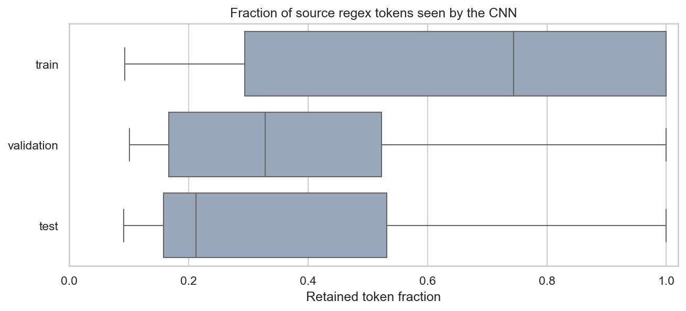
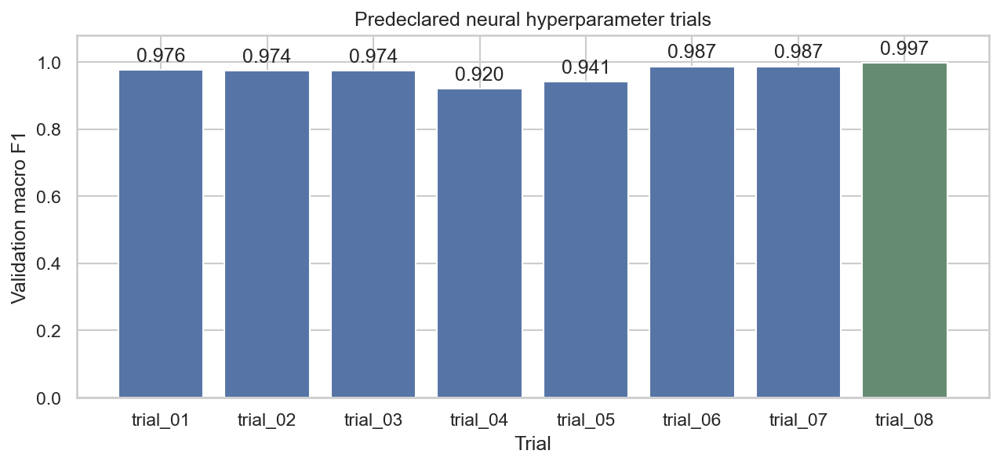
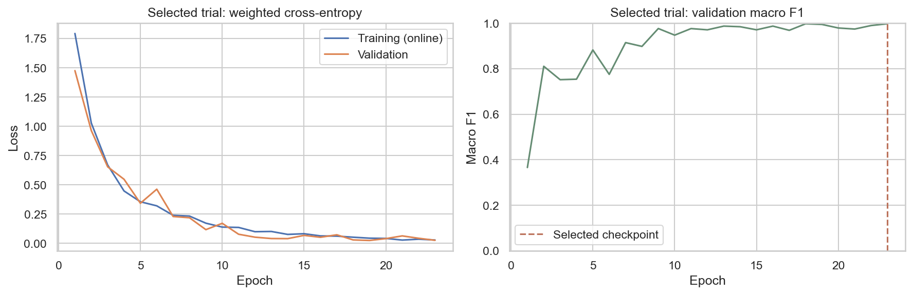
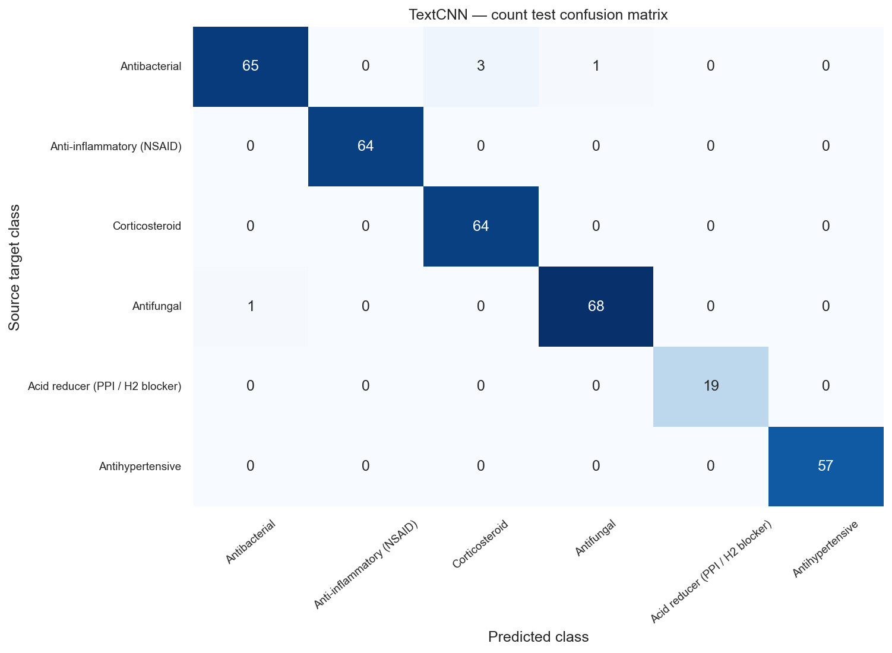
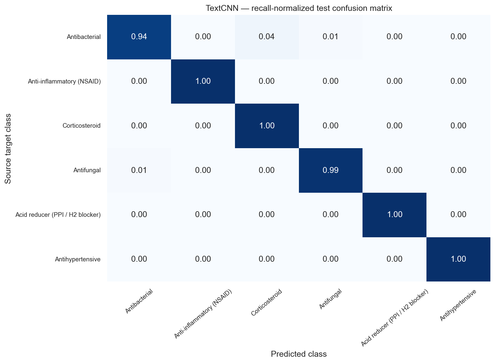
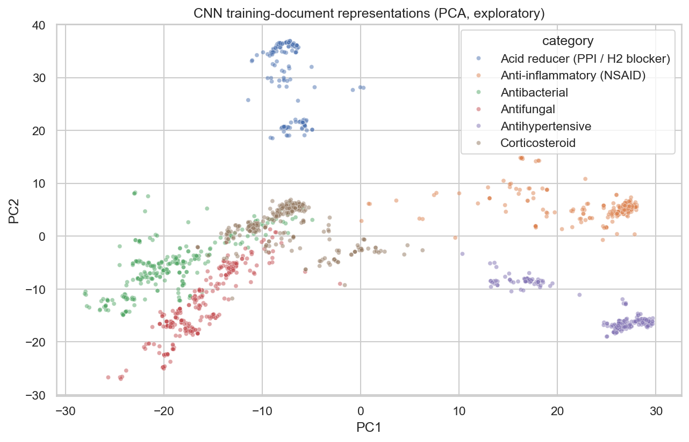

# Phase 3 — PyTorch text classifier review

## Result

A **multi-window TextCNN** was trained from scratch with a learned word embedding,
PyTorch Dataset/DataLoader, class-weighted loss, hyperparameter tuning, and early
stopping. The selected deep model is saved in `../models/phase3/text_cnn.pt`.

- Selected trial: **trial_08**; parameters: `{'learning_rate': 0.003, 'batch_size': 32, 'dropout': 0.5}`.
- Validation macro F1: **0.9972**.
- Frozen test accuracy / macro F1: **0.9854 / 0.9876**.
- Group-balanced test macro F1: **0.9859**.
- Final fixed-epoch refit: **23 epochs**, **2129 train/validation documents**.
- Learnable parameters: **1,306,214**.
- Experiment integrity: **95 checks passed**.

## Comparison with classical baselines

| Model | Validation F1 | Test accuracy | Test precision | Test recall | Test macro F1 | Group-balanced test F1 |
| --- | --- | --- | --- | --- | --- | --- |
| Logistic Regression | 0.8355 | 0.9766 | 0.9815 | 0.9807 | 0.9799 | 0.9327 |
| Linear SVM | 0.8565 | 0.9561 | 0.9684 | 0.9638 | 0.9622 | 0.9643 |
| Random Forest | 0.8671 | 0.9708 | 0.9772 | 0.9758 | 0.9751 | 0.9688 |
| PyTorch TextCNN | 0.9972 | 0.9854 | 0.9876 | 0.9879 | 0.9876 | 0.9859 |



The CNN's test macro F1 is **0.0125 higher** than the preselected
Random Forest benchmark. All classical results are retained. A deep model is not
assumed to outperform TF-IDF on this small, source-derived corpus; the comparison
is reported from the actual recorded predictions.

## Architecture and text handling

```text
Clinical document text
 → fixed Unicode-aware word tokenizer
 → frequency vocabulary (PAD=0, UNK=1)
 → up to 8 contiguous windows × 256 tokens
 → learned 64-dimensional word embeddings
 → Conv1D banks with widths 3, 4, 5 and 32 filters each
 → padding-masked max/mean pooling across document windows
 → pooled embedding mean + dropout + six-class linear head
```

Convolutions are applied within each contiguous source window; nonadjacent
passages are not concatenated into artificial phrases. Long labels include the
first and last windows plus evenly spaced middle windows. Labels at most 2,048
regex tokens long are retained in full. PAD-touching convolution windows are
excluded from pooling, and empty chunks cannot affect logits.

The vocabulary is learned from training text only during tuning, then relearned
on train + validation for the final refit. Raw clinical text remains the source;
normalization/token sampling is an input representation. No metadata, identifiers,
source URLs, ingredient fields, or test text are included in vocabulary fitting.

## Context coverage

| split | documents | mean_tokens | mean_seen | mean_retention | mean_unknown |
| --- | --- | --- | --- | --- | --- |
| train | 1762 | 4372.1759 | 1419.7015 | 0.6574 | 0.0014 |
| validation | 367 | 7995.1689 | 1924.5341 | 0.4147 | 0.0003 |
| test | 342 | 9564.4211 | 1978.1199 | 0.3417 | 0.0143 |



These are regex-token counts, which differ from Phase 1 whitespace word counts.
The CNN has a **2,048-token document budget**; TF-IDF processes full document text.
This input-budget difference is part of the model comparison and can affect
results. Unknown ratios describe encoded tokens missing from the fitted vocabulary.
The source corpus and frozen group-separated split are the same for every model.

## Tuning and early stopping

| trial_id | learning_rate | batch_size | dropout | best_epoch | epochs_run | validation_macro_f1 |
| --- | --- | --- | --- | --- | --- | --- |
| trial_01 | 0.001 | 16 | 0.2 | 19 | 24 | 0.976 |
| trial_02 | 0.001 | 16 | 0.5 | 24 | 24 | 0.9741 |
| trial_03 | 0.001 | 32 | 0.2 | 7 | 12 | 0.9741 |
| trial_04 | 0.001 | 32 | 0.5 | 13 | 18 | 0.9196 |
| trial_05 | 0.003 | 16 | 0.2 | 3 | 8 | 0.9406 |
| trial_06 | 0.003 | 16 | 0.5 | 13 | 18 | 0.987 |
| trial_07 | 0.003 | 32 | 0.2 | 13 | 18 | 0.9865 |
| trial_08 | 0.003 | 32 | 0.5 | 23 | 23 | 0.9972 |



Eight combinations of learning rate, batch size, and dropout were declared before
training. AdamW uses class-weighted cross-entropy, weight decay, and gradient
clipping. The limit is 24 epochs with patience 5 and minimum meaningful validation
macro-F1 improvement 0.0001. Checkpoints use the highest validation macro F1, with
lower validation loss as the tie-break. Small/tied checkpoint updates do not reset
early-stopping patience unless the primary metric meaningfully improves.



The best trial was selected on the 367-document validation partition. Its selected
epoch count was then fixed for a fresh train + validation refit, matching the
classical models' fit partition. Test inference occurred only after this selection
and refit. Trial/checkpoint records, loss curves, and token vocabularies are saved
under `phase3/`. Completed trials can be reused after an interrupted run.

## Class results and source-linked errors

| class_label | precision | recall | f1 | support | groups |
| --- | --- | --- | --- | --- | --- |
| Antibacterial | 0.9848 | 0.942 | 0.963 | 69 | 5 |
| Anti-inflammatory (NSAID) | 1.0 | 1.0 | 1.0 | 64 | 2 |
| Corticosteroid | 0.9552 | 1.0 | 0.9771 | 64 | 2 |
| Antifungal | 0.9855 | 0.9855 | 0.9855 | 69 | 2 |
| Acid reducer (PPI / H2 blocker) | 1.0 | 1.0 | 1.0 | 19 | 2 |
| Antihypertensive | 1.0 | 1.0 | 1.0 | 57 | 3 |





Errors and source links are in [`phase3/test_errors.csv`](phase3/test_errors.csv).
The test set has **15 independent components**, with limited ingredient coverage
in some classes. Targets come from pharmacologic-class metadata and are not
expert-adjudicated clinical indications.

## Optional representation experiment



PCA visualizes the final CNN's pooled representations for **training documents
only**. It is an exploratory illustration of learned features, not a held-out
performance estimate or a medical clustering result.

## Hardware and reproduction

Training device: `cpu`; PyTorch:
`2.8.0+cpu`; CPU threads: `4`.
The initial run uses a compact CPU model because the local GPU was occupied.
Seeds and deterministic PyTorch settings are recorded. CUDA execution is supported
when a compatible PyTorch installation/device is available.

## Deliverables and review checkpoint

- `../models/phase3/text_cnn.pt` — standalone model state, vocabulary, architecture, and provenance
- `../models/phase3/trials/*.pt` — best validation checkpoint for every candidate
- `phase3/trial_comparison.csv` and `trial_*_history.csv` — tuning and learning curves
- `phase3/model_selection.json` — pre-test selection and fixed refit epoch count
- `phase3/token_coverage.csv` — context-budget and vocabulary coverage by source record
- `phase3/model_comparison.csv` — all three classical families plus the CNN
- `phase3/predictions_test.csv` — recorded predictions/logits/source links
- `phase3/validation.json` — data-isolation, checkpoint, loss, and metric checks
- `../notebooks/03_pytorch_text_classifier.ipynb` — executed review notebook
- `../docs/neural_model_card.md` — usage and model scope

Review the actual model comparison, learning curves, text-coverage tradeoff,
class-level errors, and checkpoint usage. The next course phase is BERT fine-tuning
and a document-grounded RAG chatbot, after your review.

Data provided by the U.S. Food and Drug Administration (<https://open.fda.gov>).

This product uses publicly available data from the U.S. National Library of Medicine (NLM), National Institutes of Health, Department of Health and Human Services; NLM is not responsible for the product and does not endorse or recommend this or any other product.

As specified in the original plan, the project is informational only and is not
medical advice. The classifier is a closed-set English medicine-label model.
