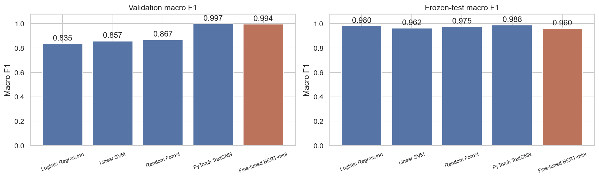
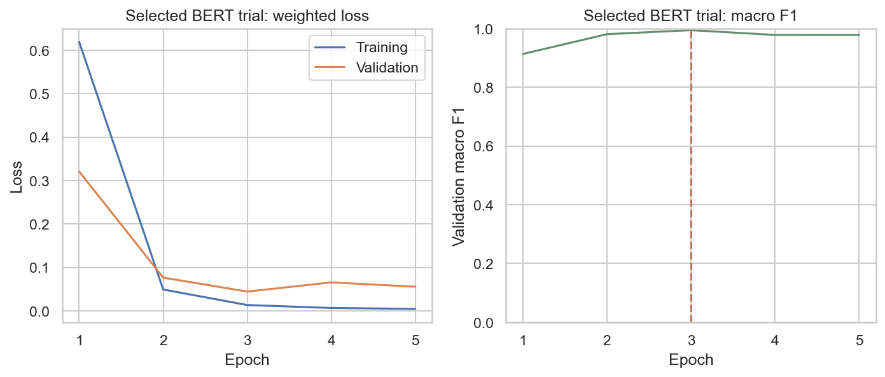
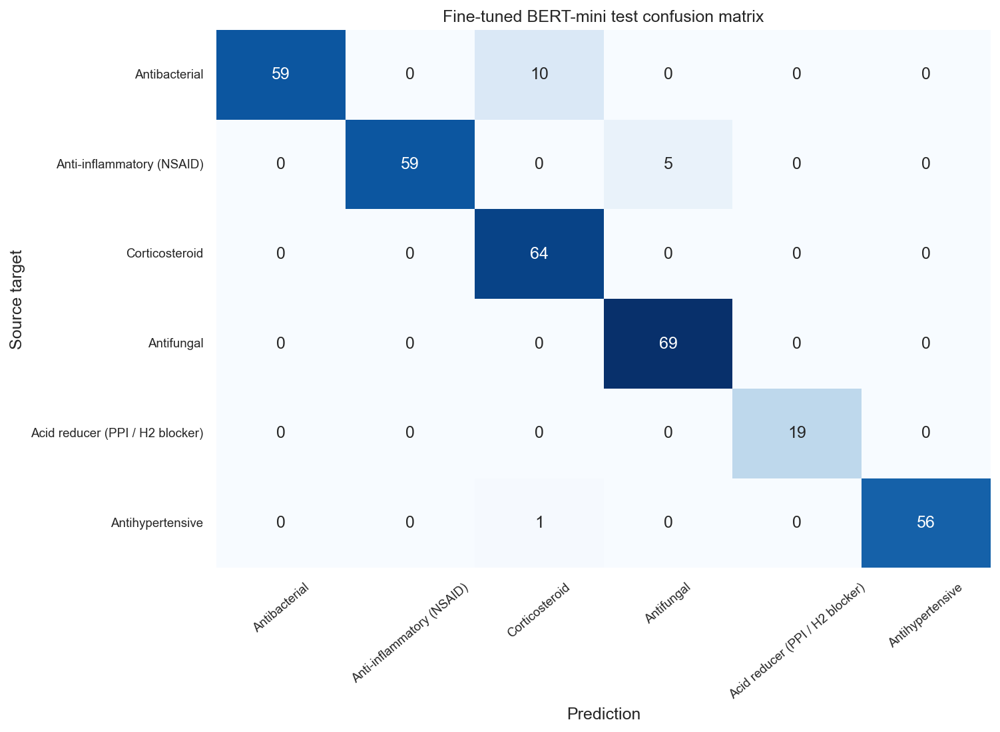
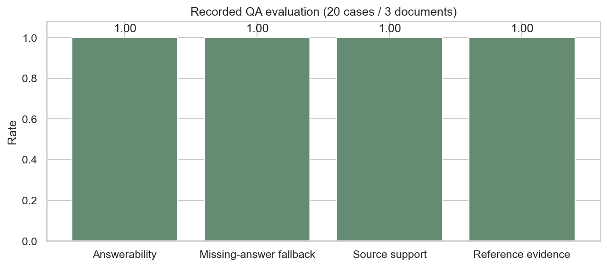

# Phase 4 — BERT + grounded document QA review

## Result

Phase 4 delivers **fine-tuned BERT-mini** and a **local, source-quoted RAG assistant**.
The classifier checkpoint, semantic embeddings, per-document FAISS storage,
answerability model, and local instruction model are available in the project.

- BERT validation macro F1: **0.9944**.
- BERT test accuracy / macro F1: **0.9532 / 0.9597**.
- Selected BERT rate / fixed refit epochs: **5e-05 / 3**.
- QA evaluation: **20 cases** across **3 source documents**.
- Missing-answer cases correctly declined: **9 / 9**.
- Answerable reference evidence covered: **100.00%**.
- Returned answer/citation source support: **100.00%**.
- Artifact verification: **54 checks passed**.

## Classifier comparison

| Model | Validation F1 | Test accuracy | Test precision | Test recall | Test macro F1 | Group-balanced F1 |
| --- | --- | --- | --- | --- | --- | --- |
| Logistic Regression | 0.8355 | 0.9766 | 0.9815 | 0.9807 | 0.9799 | 0.9327 |
| Linear SVM | 0.8565 | 0.9561 | 0.9684 | 0.9638 | 0.9622 | 0.9643 |
| Random Forest | 0.8671 | 0.9708 | 0.9772 | 0.9758 | 0.9751 | 0.9688 |
| PyTorch TextCNN | 0.9972 | 0.9854 | 0.9876 | 0.9879 | 0.9876 | 0.9859 |
| Fine-tuned BERT-mini | 0.9944 | 0.9532 | 0.9643 | 0.9599 | 0.9597 | 0.9124 |



The compact BERT did not outperform the TextCNN on this test snapshot. The
comparison retains all measured results rather than replacing earlier models.
BERT uses **4 layers / hidden size 256**, with up to **two 256-token windows**
(508 content WordPieces). CNN uses up to 2,048 regex tokens; TF-IDF uses full text.
Model capacity and context budgets differ and are explicitly part of the comparison.





Both learning-rate candidates were fine-tuned using training text/labels and
validation selection with early stopping. The selected epoch count was fixed,
then the model was freshly refit on train + validation before test inference.
All five model families share the same frozen corpus, class labels, and record
split. The pretrained tokenizer is fixed; it is not fitted to test text.

## Grounded QA architecture

```text
One uploaded/pasted document
 → source-preserving WordPiece chunks (180 tokens, overlap 40)
 → sentence-transformer MiniLM embeddings (384 dimensions, normalized)
 → independent document FAISS IndexFlatIP
 → semantic top-4 retrieval + explicit-section retrieval for broad FAQ questions
 → question-focus and SQuAD2 answerability checks
 → local FLAN-T5-small answer-span generation
 → literal-source/answer-type verification
 → source quotation + exact citation offsets, or missing-answer fallback
```

Indexes are isolated by a SHA-256 document ID. Each stored index includes the
canonical cleaned text, chunk offsets, vectors, FAISS data, model revision, and
file checksums. Retrieval never searches another uploaded document's index.
Chunking explicitly disables any leftover tokenizer truncation before processing
the full source; every document's tail remains indexable.

Broad requests about named leaflet sections return the explicit source section
or an excerpt. Specific questions use the answerability model's checked span.
The local LLM receives retrieved source passages. Its answer span is accepted
only when it matches the validated source span; otherwise a grounded extractive
quote is used. Rejected generated text is not exposed as an answer or metadata.
The returned quote includes nearby source-clause context to retain conditions.

Missing or unsupported evidence returns exactly:

> I cannot find that in the document.

No answer is inferred from the drug classifier, model world knowledge, or another
document. Current responses are source quotations, not individualized medical
recommendations or unconstrained summaries.

## QA benchmark and measured limits

The **48 authored MedQuAD-style pairs** use **7 real source-linked FDA leaflets**:
8 development cases, 20 calibration cases, and 20 evaluation cases. Positive
reference answers are exact source sections/spans; no medical facts were invented.
These are project-authored source-linked templates, not the original MedQuAD
dataset. Evaluation ingredient components differ from development/calibration.



- Answerable cases: **11**; missing-answer cases: **9**.
- Answerability accuracy: **100.00%**.
- Reference-evidence coverage: **100.00%**.
- Missing-answer fallback rate: **100.00%**.
- Literal answer/citation support: **100.00%**.

The initial evaluation had reference coverage **90.91%**:
one frequency question received a supported but irrelevant strength description.
A general temporal-answer guard was added and the evaluation rerun under policy
version 2. Original results are retained in `phase4/rag/archive/policy_v1/`.
The updated score is therefore a documented post-correction regression result,
not a fresh untouched test estimate. No BERT weights/hyperparameters were changed
using these QA findings.

This small benchmark is dominated by broad section FAQs and simple span queries.
It checks source grounding, document isolation, and missing-answer behavior; it
does not establish clinical reliability or performance on all medical questions.
Open text without recognized headings relies on the answerability/semantic path
and may correctly decline questions. Source texts themselves are not independently
medically adjudicated by the project.

## Pinned model runtimes and attribution

| Role | Model | Revision | License |
| --- | --- | --- | --- |
| bert | google/bert_uncased_L-4_H-256_A-4 | 387825ce42db | apache-2.0 |
| embedding | sentence-transformers/all-MiniLM-L6-v2 | 1110a243fdf4 | apache-2.0 |
| qa | deepset/minilm-uncased-squad2 | 934656cdda79 | cc-by-4.0 |
| generation | google/flan-t5-small | 0fc9ddf78a1e | apache-2.0 |

Model cards, immutable revisions, asset hashes, and licenses are recorded in
`phase4/model_assets.json`. The QA model is by **deepset**, distributed under
**CC BY 4.0**; see <https://huggingface.co/deepset/minilm-uncased-squad2>.
The Google BERT/FLAN and sentence-transformer assets are Apache 2.0 model releases.

## Try the components

```powershell
.\.venv\Scripts\python.exe -m medical_doc_assistant classify-bert --file "data/examples/phase2_demo_leaflet.txt"
.\.venv\Scripts\python.exe -m medical_doc_assistant ask --file "data/examples/phase2_demo_leaflet.txt" --question "How long can this product take for full effect?"
.\.venv\Scripts\python.exe -m medical_doc_assistant chat --file "data/examples/phase2_demo_leaflet.txt"
```

`index-document --file ...` persists an index and prints its document ID.
`ask --document-id <sha256> --question ...` reuses that document. The interactive
chat asks explicit questions about the same document; it does not infer facts
from an implicit personal history.

## Deliverables and review checkpoint

- `../models/phase4/bert/model.pt` + `tokenizer/` — standalone fine-tuned classifier
- `phase4/bert/model_comparison.csv` — all five measured classifier results
- `../data/indexes/<document_sha256>/` — independent persisted vector indexes
- `../data/evaluation/phase4_qa_cases.json` — source-linked QA references
- `phase4/rag/evaluation_responses.json` — questions, answers, offsets, and passages
- `phase4/model_assets.json` — model revisions/licenses/file hashes
- `phase4/validation.json` — classifier/data/index/grounding checks
- `../notebooks/04_bert_and_grounded_qa.ipynb` — executed review notebook
- `../docs/phase4_model_cards.md` — component usage and scope

Review the classifier comparison, model-size/context tradeoffs, QA examples,
literal evidence, fallback behavior, and benchmark limits. The next phase is
FastAPI/Streamlit, Docker/deployment, and capstone documentation, after review.
English is the evaluated path; Arabic remains an explicitly scoped extension.

Data provided by the U.S. Food and Drug Administration (<https://open.fda.gov>).

This product uses publicly available data from the U.S. National Library of Medicine (NLM), National Institutes of Health, Department of Health and Human Services; NLM is not responsible for the product and does not endorse or recommend this or any other product.

As required by the original plan, this project is informational only and is not
medical advice.
